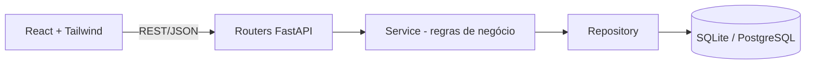

# 🔗 URL Shortener

Encurtador de URLs full stack com analytics de cliques, construído com foco em **código limpo, arquitetura em camadas e infraestrutura reproduzível**.


> 📸 

## ✨ Funcionalidades

- Validação de URLs (apenas `http`/`https` bem formadas) e geração de códigos curtos únicos
- Links legíveis: o código começa com o nome do site de destino 
- Redirecionamento (HTTP 307) com registro de cliques
- QR Code por link, gerado no frontend, com download em PNG (alta resolução) e SVG (vetorial)
- Listagem dos links criados com contagem de cliques
- Interface responsiva com estados de carregamento, erro e sucesso
- API documentada automaticamente (OpenAPI/Swagger em `/docs`)

## 🏗️ Arquitetura



| Camada | Responsabilidade |
|---|---|
| **Router** | HTTP: validação de entrada (Pydantic), status codes |
| **Service** | Regras de negócio: geração de código, colisões, contagem de cliques |
| **Repository** | Único ponto que conhece o SQLAlchemy |
| **Exceptions** | Erros de domínio traduzidos para HTTP em handlers centralizados |

Princípios aplicados: **SRP** (uma responsabilidade por camada), **DIP** (o service recebe repositório e gerador de código por injeção, o que permite testá-lo com fakes) e configuração via variáveis de ambiente (12-factor).

## 🧰 Stack

- **Backend:** Python 3.12, FastAPI, SQLAlchemy 2.0, Pydantic v2
- **Banco:** SQLite (padrão) com suporte a PostgreSQL trocando apenas `DATABASE_URL`
- **Frontend:** React (Vite), Tailwind CSS, lucide-react, qrcode.react
- **Infra:** Docker, Docker Compose, Nginx (multi-stage build)
- **Testes:** pytest, httpx/TestClient

## 🚀 Como rodar (Docker)

```bash
git clone https://github.com/SEU-USUARIO/encurtador-url.git
cd encurtador-url
docker compose up --build
```

- Frontend: http://localhost:3000
- API + Swagger: http://localhost:8000/docs

## 💻 Rodando localmente (sem Docker)

```bash
# Backend
cd backend
python -m venv .venv && source .venv/bin/activate   # Windows: .venv\Scripts\activate
pip install -r requirements-dev.txt
uvicorn app.main:app --reload

# Frontend (outro terminal)
cd frontend
npm install
npm run dev
```

## 🧪 Testes

```bash
cd backend && pytest -v
```

## 📡 Endpoints

| Método | Rota | Descrição |
|---|---|---|
| `POST` | `/api/urls` | Cria um link curto `{ "url": "https://..." }` |
| `GET` | `/api/urls` | Lista links com contagem de cliques |
| `GET` | `/{short_code}` | Redireciona para a URL original e registra o clique |
| `GET` | `/health` | Health check |

## 🧠 Desafios técnicos e decisões

- **Colisão de códigos sem race condition:** em vez de consultar e depois inserir, o código é inserido e a constraint `UNIQUE` do banco decide; em caso de conflito há retry. Funciona corretamente mesmo com múltiplas instâncias.
- **Contagem de cliques concorrente:** `UPDATE ... SET clicks = clicks + 1` atômico no banco, evitando "lost updates" do padrão ler-incrementar-gravar na aplicação.
- **307 em vez de 301:** redirecionamentos permanentes são cacheados pelo navegador, o que faria cliques repetidos não chegarem ao servidor e distorceria o analytics.
- **Portabilidade de banco:** a camada de repositório isola o ORM; migrar para PostgreSQL exige só alterar a `DATABASE_URL`.
- **Imagem Docker enxuta e segura:** build multi-stage no frontend e usuário não-root no backend.
- **QR Code sem backend:** gerado no cliente (SVG para exibição, canvas 1024px para o PNG). O QR codifica o link curto, não o destino final, então o código impresso continua válido se o destino mudar.
- **Códigos criptograficamente aleatórios:** `secrets` em vez de `random`, tornando os links não-previsíveis (62^7 ≈ 3,5 trilhões de combinações).

## 🗺️ Roadmap

- [ ] Migrações com Alembic
- [ ] Rate limiting por IP
- [ ] Alias personalizado e expiração de links
- [ ] Analytics detalhado (data, user-agent, país)
- [ ] CI com GitHub Actions (lint + testes)

